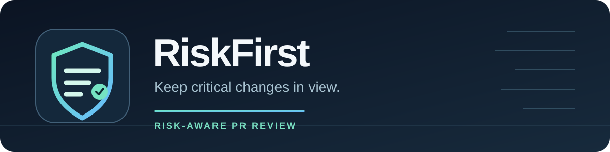
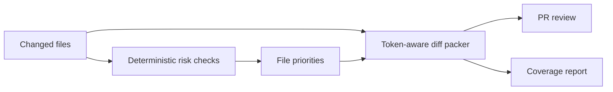

<p align="center">
  
</p>

<p align="center">
  <strong>Risk-aware coverage for large pull request reviews.</strong><br>
  An open-source portfolio fork of <a href="https://github.com/The-PR-Agent/pr-agent">PR-Agent</a>.
</p>

<p align="center">
  <a href="#why-riskfirst">Why RiskFirst</a> ·
  <a href="#how-it-works">How it works</a> ·
  <a href="#try-it">Try it</a> ·
  <a href="#validation">Validation</a>
</p>

---

## Why RiskFirst

An AI review can only analyze files that fit inside its model's input budget. In a large pull request, PR-Agent compresses the diff and reports files it could not include. Its established packing order groups files by language and favors larger patches. That order can spend scarce context on a long, routine change before reaching a smaller security or migration change.

RiskFirst adds **opt-in risk-aware compression** to `/review`. When the full diff fits, the review input stays the same. When it does not fit, RiskFirst uses PR-Agent's existing deterministic risk checks to order the files before packing them:

| Priority | Signal | Example |
| --- | --- | --- |
| 1 | Risky change shape found in the diff | Destructive SQL or changed authentication logic |
| 2 | Sensitive path | Migration, workflow, dependency manifest, or Dockerfile |
| 3 | Changed test with a filename matching a prioritized file | `tests/test_auth.py` for `src/auth.py` |
| 4 | Original language and patch-size order | Other changed files |

The packer still enforces the same token limit. The existing coverage footer still identifies omitted or clipped files. No additional model call is required.

## How it works



The feature is limited to `/review`. It supports both the normal compressed review and optional large-PR chunking. It reuses one risk scan for ordering and for the published risk summary.

| Area | Change |
| --- | --- |
| `pr_agent/algo/review_file_priority.py` | Builds deterministic priority levels and pairs conventional test names with changed files. |
| `pr_agent/algo/pr_processing.py` | Applies the priority order only when the diff exceeds the budget; retains the original order within each level. |
| `pr_agent/tools/pr_reviewer.py` | Connects `/review` to the shared risk checks and the single-call and chunked packers. |
| `pr_agent/settings/configuration.toml` | Adds the opt-in setting. |
| `tests/unittest/` | Checks coverage under a fixed budget, renames, chunking, the opt-in path, and full-diff behavior. |

## Try it

You need Python 3.12 or newer and `uv` 0.13.7 or newer. From a checkout of this repository:

```bash
uv sync
PYTHONPATH=. uv run pytest tests/unittest/test_risk_aware_compression.py -q
```

Turn on the feature in your repository's `.pr_agent.toml` or host configuration:

```toml
[pr_reviewer]
enable_risk_aware_compression = true
```

`pr_reviewer.enable_risk_checks` must also be enabled; it is on by default. For a live review, configure your Git provider and model credentials, then run `/review` through your normal PR-Agent deployment. The [review guide](docs/docs/tools/review.md) explains the setting and the [upstream installation guide](https://docs.pr-agent.ai/installation/) covers deployment options.

## Validation

The fixed-budget test uses a documentation patch, a migration containing `DROP TABLE`, its matching test, and an ordinary source file. With the original order, the migration is omitted. With risk-aware compression, the same budget includes the migration and its test while listing the omitted documentation file.

This verifies **which files reach the model**, not whether the model finds more real bugs. Risk patterns and filename matches are heuristics. A lower-priority file may still contain a severe bug, and the feature does not calculate a dependency graph. Keep the coverage footer enabled and review omissions yourself.

Run the full unit suite with:

```bash
PYTHONPATH=. uv run pytest tests/unittest -q
```

## Origin and license

RiskFirst is a fork of [The-PR-Agent/pr-agent](https://github.com/The-PR-Agent/pr-agent). The underlying review tools, provider integrations, model support, and most of this codebase come from that project and its contributors. The risk-aware compression changes and this README are additions in this fork. The repository retains the upstream [MIT license](LICENSE).
